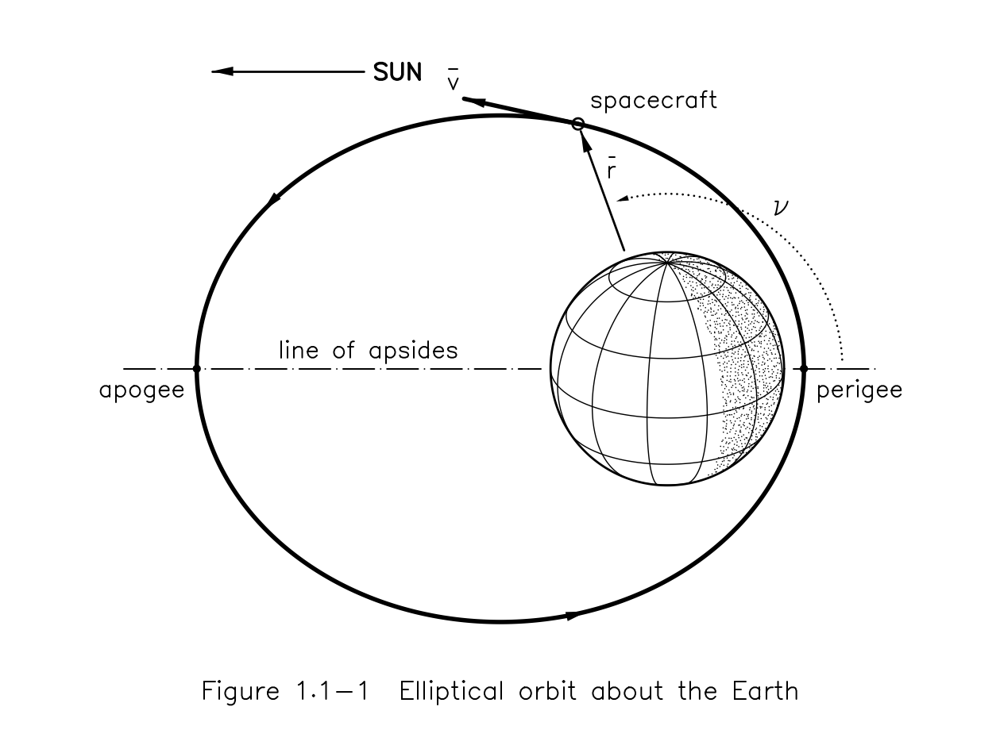
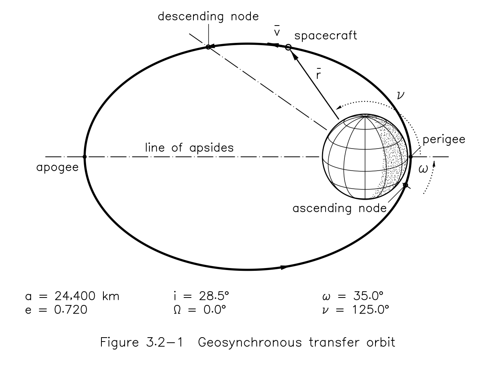
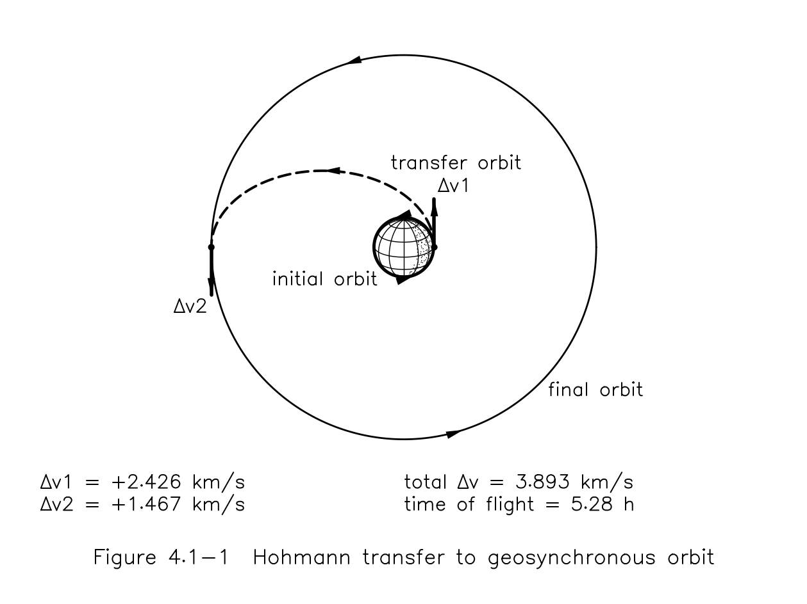
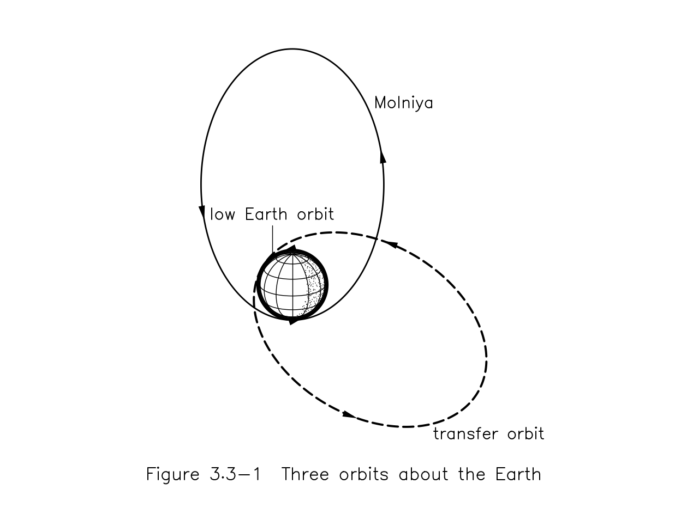
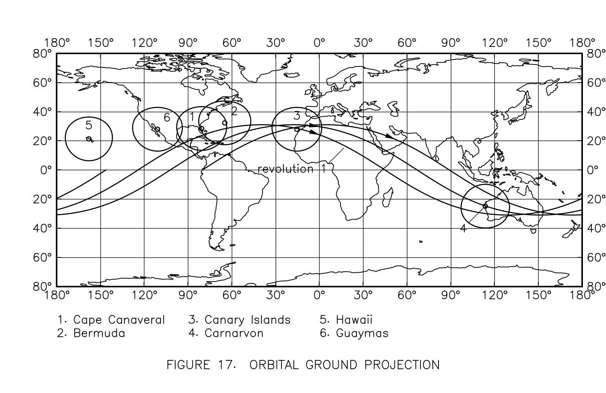
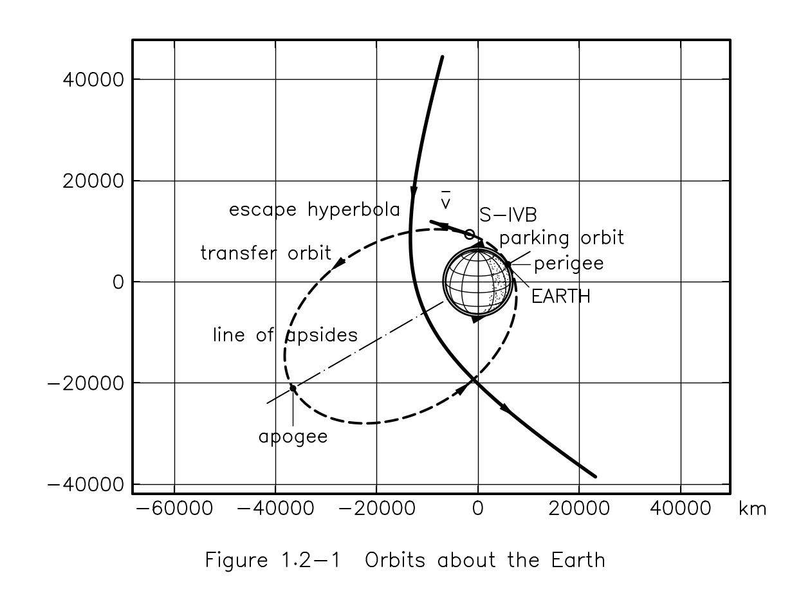

# inkorbit

Orbital diagrams in the style of 1960s black-and-white technical print: technical-pen
line weights, stippled night sides, drafting arrowheads and single-stroke lettering.



## Ready-made diagrams

Each diagram is one call, by name or as a function, and returns a `Plate` you can keep
drawing on, save, or show in a notebook:

```python
import numpy as np
import inkorbit as ink

gto = ink.Elements(a=24_400, e=0.72, i=np.radians(28.5), argp=np.radians(35), nu=np.radians(125))
ink.diagram("orbit", gto, caption="Figure 3.2-1  Geosynchronous transfer orbit").savefig("gto.png")
ink.diagram("orbits", leo, molniya, gto, names=["low Earth orbit", "Molniya", "transfer orbit"])
ink.diagram("hohmann", 6_678, 42_164)  # radii in km
ink.diagram("ground_track", lat, lon, stations=[("Cape Canaveral", 28.4, -80.6, 15)])
```

| `"orbit"` | `"hohmann"` |
|---|---|
|  |  |
| **`"orbits"`** | **`"ground_track"`** |
|  |  |

### Works with poliastro, hapsira, Skyfield and astropy

Pass their objects straight in. inkorbit reads them by their attributes and never
imports poliastro, hapsira or astropy itself, so install whichever you use:

- a poliastro or hapsira `Orbit` wherever an orbit goes (its attractor sets the body,
  its size and what the apsides are called: perigee, perilune, perihelion...),
- astropy `Quantity` lengths and angles anywhere a number goes,
- a Skyfield position over several times as a ground track (`ink.diagram("ground_track", sat.at(t))`)
  or as an orbit's sampled positions.

## Building blocks

```python
import numpy as np
import inkorbit as ink
from inkorbit import draw

orbit = ink.Elements(a=2.6, e=0.55, nu=np.radians(110))  # Earth radii, radians

scene = ink.Scene(caption="Figure 1.1-1  Elliptical orbit about the Earth")
draw.body(scene, radius=1.0, tilt=np.radians(25))
draw.orbit(scene, orbit)
draw.apsides(scene, orbit, body_radius=1.0)  # perigee, apogee, line of apsides
draw.radius_vector(scene, orbit, body_radius=1.0)
draw.velocity_vector(scene, orbit, length=1.0)
draw.spacecraft(scene, orbit, label="spacecraft")
draw.true_anomaly(scene, orbit, radius=1.5)
scene.render().savefig("orbit.png")
```

Labels are placed automatically so they avoid lines and each other (`scene.labels = False`
hides them). Axes and a grid are off by default: `ink.Scene(axes=True, grid=True, units="km")`.



## Install (development)

```bash
uv sync
uv run python examples/proof_of_style.py
uv run pytest
```

## How it fits together

```
Scene  ──layout──▶  Drawing  ──renderer──▶  image
data coordinates    page millimetres       matplotlib (for now)
```

- **`draw`**: building blocks (orbit, body, apsides, nodes, angle, vectors, spacecraft)
  that add to a scene. Orbits come from `Elements` or from arrays of 2D or 3D positions.
- **`Scene`**: what to draw, in your data units (km, Earth radii...). Lines carry a
  *role* (`orbit`, `transfer`, `apse`, `construction`, `grid`...) instead of a colour or width.
- **`Style`**: decides how each role looks: technical pen widths in mm, dash patterns,
  lettering, arrowheads, stipple and hatch density.
- **`layout`**: puts the scene on a page, resolves every physical size and turns text,
  arrows, markers and fill patterns into plain ink: strokes, solid polygons and dots.
- **Renderers** draw only those three things, so adding a backend besides matplotlib
  is small.

```python
import inkorbit as ink
from inkorbit import geometry as geo, style as st

scene = ink.Scene(caption="Figure 1  A transfer orbit")
scene.line(geo.circle((0, 0), 1.0), st.OUTLINE)
scene.line(geo.ellipse(2.0, 0.5), st.ORBIT, arrows=(0.3, 0.8))
scene.text("perigee", (1.0, 0), offset_mm=(1.5, -3))

fig = scene.render(page="figure")  # 160 x 120 mm
fig.savefig("transfer.png")  # 300 dpi
fig.data_ax.plot(...)  # keep drawing with matplotlib, in data units
```

In Jupyter a `Scene` (or a rendered figure) displays itself as the last line of a cell.

## Credits

Map data: made with [Natural Earth](https://www.naturalearthdata.com/) (public domain).
Lettering uses the Hershey vector fonts, created by Dr. A. V. Hershey at the U.S.
Naval Weapons Laboratory, via the MIT-licensed
[Hershey-Fonts](https://github.com/apshu/HersheyFonts) package.
